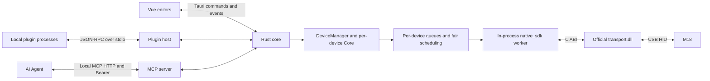

# Architecture and Implementation Constraints

## Layering principles

Entry points express intent through application services rather than manipulating files, device handles, or child processes. The domain layer owns validation, permissions, configuration, transactions, and lifecycle. Adapters encapsulate native libraries and OS differences without exposing handles or internal locks.

Keep drafts, persisted configuration, hardware readback, and command results separate. Queues have explicit ordering, budgets, expiry, cancellation, and shutdown boundaries. Validation, persistence, interface acceptance, transport submission, and physical observation establish different outcomes.

## Implementation map

- `crates/device-api` defines devices, configuration, input, batches, receipts, and the adapter/host contract without depending on Tauri or Core. The host reuses these models; registered module types join ts-rs binding generation.
- `storage` handles versions, atomic persistence, asset hashes, and image limits. `render` composes output for the target display dimensions; the editor uses the same cached rendering path.
- Each device's `core` owns pages, runtime state, input actions, coalescing, complete page batches, cancellation, logs, and hardware-verification metadata. Page preparation finishes before one batch is queued and submitted. Launch actions run on background workers, outside the device queue.
- M18's `sdk` validates pinned resources, supervises ownership/connections, normalizes input, and maps output key numbers. Installed builds use installed resources exclusively and reject missing or mismatched files.
- `crates/device-m18` contains the sole physical M18 backend, `native_sdk`. Its dedicated worker loads official `transport.dll` and serializes images, backgrounds, screen settings, LEDs, GIFs, and queries. A separate read thread emits typed input. Page images are pre-encoded, submitted continuously, and followed by one `transport_refresh`. Readers finish before handle destruction and library unload.
- `led` preserves base colors, brightness, and modes and produces immutable RGB-dimmed output instead of using the incompatible native M18 LED-brightness command.
- `plugins` owns local process lifecycle, size/time limits, API permissions, temporary-override ownership, binding-driven startup, persistent disabled state, and explicit error retry.
- `widgets` owns expiring samples and latest in-memory frames. Plugins publish descriptions; the host's generic Rust renderer follows saved bindings. Normal commands and page batches take priority, and all final M18 output uses `native_sdk`. Collection runs in the separate performance-plugin process.
- `mcp` owns optional local HTTP, independent settings/tokens, compatible temporary tools, and typed application-management tools. It reuses core queues and cancels unsent work by source when stopping; it opens no second SDK connection.
- `app` exposes typed UI commands and manages Tauri lifecycle. The frontend never connects to the SDK. Launching uses typed actions, explicit test-launch requests and authorized MCP management jobs.

`WorkspaceServices` shares assets, icons, and application discovery. Audio Dock state and settings belong to its adapter crate; the host carries generic module-state JSON. Adapters retrieve work through `AdapterHost` and cannot access Core locks. DeviceManager supervises independent device runtimes; UI selection changes only the editing target. See [Device modules](DEVICES.md).

## Persistence and transport

Page persistence and hardware updates are separate operations. Report saved state only after atomic persistence. Every queued operation has its own receipt ID. The direct SDK return determines acceptance/failure; do not infer association from similarly named messages. `acknowledged` means SDK acceptance, not completed drawing or physical verification.

Everyday temporary backgrounds use `transport_set_background_frame_stream`. Persistent boot-background writes use a separate explicitly confirmed interface, are never implicit in page/plugin changes, and are unavailable to MCP.

Windows x64 is the physical delivery target. Other platforms have no legacy WebSocket fallback. `sdk_pid` identifies the client/diagnostic process holding the DLL, not a helper server. Only optional MCP creates an HTTP listener; plugin stdio is independent of device transport.

## Desktop, library, and plugins

`desktop` owns app settings, language preference, native tray, window restoration, and one-time shutdown. Hiding retains WebViews and drafts; actual exit waits for editor-save checks. Ordinary instances use single-instance activation and an app lock. Hardware-free diagnostics use an isolated app lock without changing SDK ownership rules.

`library` maintains logical asset folders/items through typed commands. It publishes only after atomic index persistence. Deleting a logical entry does not remove content-addressed bytes. MCP, plugin, and test assets are not automatically added to the personal library.

`applications` owns the separate app-preset index of typed targets and arguments rather than copying program binaries. Choosing a preset copies an existing action; library, application index, and page drafts remain independent. `application_icons` extracts exe/lnk icons through Shell/WIC on blocking workers and stores content-addressed PNGs without launching programs or entering the SDK queue. Cache refreshes do not rewrite saved pages or user overrides.

`plugin_package` validates, packs, stages, and recovers `.m18plugin` ZIP/configuration transactions without executing plugin code. `plugins` serializes lifecycle operations per ID. Windows child creation uses an owned Job and explicitly inherited stdio. Disabling cancels protocol waits; after a graceful-stop deadline, reclaim the Job and confirm its process tree is empty before reporting stopped. API permissions are not an OS sandbox.

`plugin_icons` owns installed PNG catalogs and persistent runtime icon indexes. The library reads mounted snapshots rather than copying them into personal asset indexes. Stable plugin/icon IDs resolve versioned in-memory frames. Before submission, the backend rechecks page, catalog, and source generations. Uninstall/recovery transactions cover both packaged and runtime-icon directories and run before Core initialization.

## Shared input and launching

`input` validates device/path/session identity, tracks pressed state, removes duplicate edges, and dispatches background actions. `raw_input` only provides the Windows receiver thread, usage registration, and physical identity normalization. M18 reads through its SDK; Audio Dock declares Raw Input matching/decoding. Both feed the shared dispatcher. Devices without pages reject page, scene, and display operations.

`application_catalog` preserves complete AppsFolder identities and lazily loads icons. `launch_service` validates and executes Program, RegisteredApplication, and Uri targets; `launcher` and `application_icons` contain Windows Shell/COM details. Blocking work stays outside input threads and device queues. Explicit MCP application-management jobs use the same typed launch service. Plugin permissions do not gain launch access.

Production data uses the platform-v1 workspace and backup identifiers/version 1; the separate application index uses version 2. See [Applications](APPLICATIONS.md), [Pages and assets](PAGES-AND-ASSETS.md), and [Audio Dock](hardware/microsoft-audio-dock/README.md).

New hardware extends adapter capabilities rather than model-specific shared branches. App integrations belong in plugins. See [Frontend](FRONTEND.md), [Device SDK](DEVICE-SDK.md), and [Plugin protocol](PLUGIN-PROTOCOL.md).
